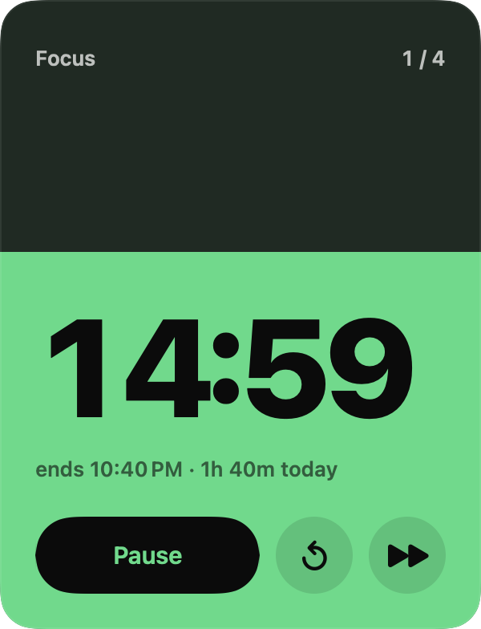
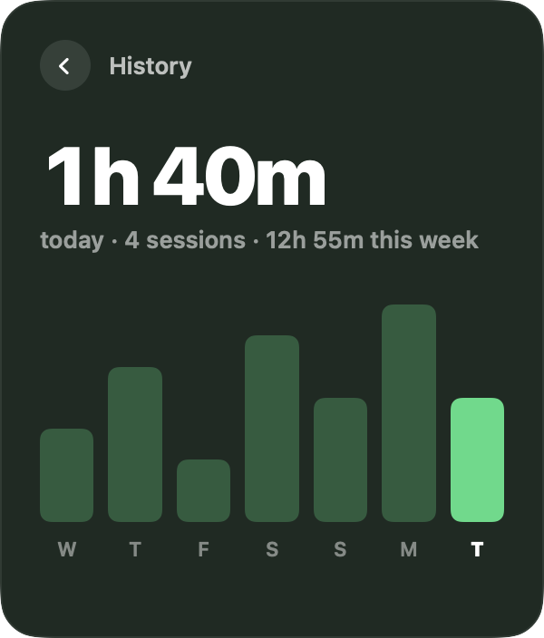
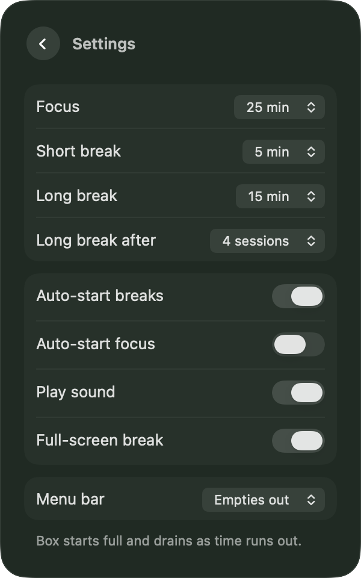

# Wolf

A free, local menu-bar Pomodoro timer for macOS. Alternating focus sessions and breaks,
with a notification and an unmissable full-screen break screen when a session ends.

No accounts, no network requests, no analytics. Everything is stored in `UserDefaults`.

<p align="center">
  
  
  
</p>

## Download

Grab `Wolf-0.4.zip` from the [latest release](https://github.com/itskofi/WolfPomodoro/releases/latest),
unzip it and move `Wolf.app` to `Applications`. The app is ad-hoc signed (not notarized), so on
first launch right-click it → **Open**, or run `xattr -dr com.apple.quarantine Wolf.app`.

## Features

- **Focus / short break / long break** durations picked from presets (15, 25, 30, 45, 50,
  60, 90 min for focus) or set to any custom value.
- **Menu bar box** — a drawn box with the remaining time inside it, whose fill tracks the
  phase. Choose whether it *empties out* or *fills up*; it turns green during breaks.
- **Full-screen break screen** on every display when a focus session ends, dismissible
  with `Esc` or a button.
- **Notifications** with your own wording for each transition.
- **History** — today's focus total, a 7-day bar chart, and per-day totals. Breaks and
  skipped (partial) sessions are recorded honestly.
- **Light, dark, or system** appearance.

## Build

Requires the Swift toolchain (Xcode or Command Line Tools) on macOS 14+.

```sh
./build.sh --install   # builds Wolf.app, ad-hoc signs it, installs to ~/Applications
./build.sh             # build only, into ./build/Wolf.app
```

## Distribution

The build is **ad-hoc signed**, which is fine locally but not for public download —
Gatekeeper will refuse it on other machines. Shipping it properly needs an Apple Developer
ID certificate, the hardened runtime, and notarization. See §9 of [PRD.md](PRD.md).

## Design

"Füllstand": the panel is a single colour field that drains as the phase runs out —
green for focus, sky blue for breaks — with heavy ink digits on top. Where the fill line
crosses text, the text is drawn twice and masked, so it stays legible on both sides. The
break screen is the same field at full-screen size. Full requirements are in [PRD.md](PRD.md).

## Licence

MIT.
